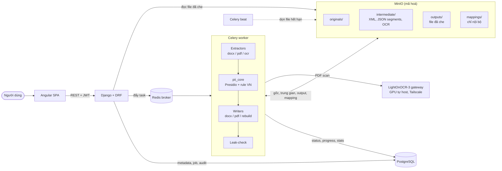
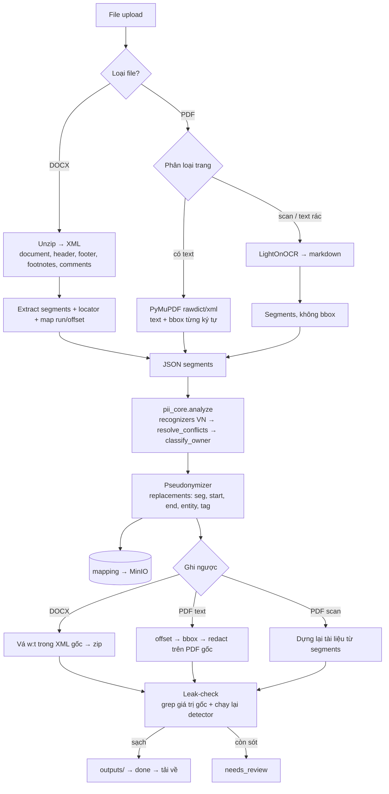
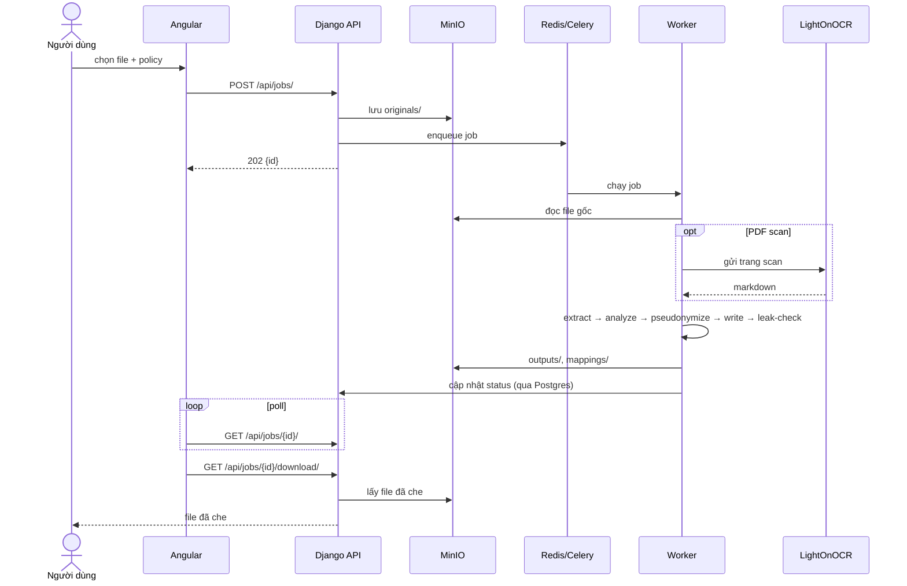

# PII Masking Web App: plan

Input: PDF/DOCX. Output: file cùng định dạng, PII đã thay bằng tag đánh số (`<PERSON_1>`, `<ADDRESS_2>`...).
Engine: Presidio + rule VN (cấu hình D của `cc1/run_cc1.py`). Backend Django, frontend Angular (làm sau).

## Quyết định đã chốt (2026-11-27)

| # | Vấn đề | Chốt |
|---|---|---|
| 1 | Kiểu che | Tag đánh số như cc1 (`Pseudonymizer`), một giá trị trong một file luôn nhận một tag |
| 2 | Output / mapping | **Output duy nhất là file đã che** (cùng định dạng input). Mapping lưu nội bộ trên **MinIO** (mã hoá), không trả qua API, không làm restore. Scale tính sau |
| 3 | PDF scan | OCR bằng gateway LightOnOCR-3 tự host (`crawl/ocr_lighton.py`, máy GPU riêng qua Tailscale) |
| 4 | Deploy | Tính sau. Dev bằng docker-compose (Postgres, Redis, MinIO) |
| 5 | Hàng đợi | **Redis + Celery**. Task chỉ mang `job_id`, không mang nội dung file. Kafka để sau, làm event bus (`job.completed`...) qua lớp `EventPublisher`, không dùng làm hàng đợi task |

## Kiến trúc

### Hệ thống



### Luồng xử lý một file



### Vòng đời job



```
app/
  pii_core/            # Python thuần, không phụ thuộc Django; eval/harness.py cũng dùng chung
    engine.py          # build_analyzer("D")
    recognizers/       # chuyển từ demo/doc.py + cc1/run_cc1.py
    policy.py          # profile chính sách: entity -> mask/keep (thay OPERATORS hardcode)
    pseudonymizer.py
    documents/  base.py  docx_handler.py  pdf_handler.py  ocr_lighton.py
    leakcheck.py
    cli.py             # python -m pii_core mask in.docx -o out.docx
  backend/             # Django: config/, jobs/, accounts/
  frontend/            # Angular (P6)
  docker-compose.yml
```

## Ghi chú P0 (xong 2026-11-27)

- `app/pii_core/`: `engine.py` (cấu hình A/D), `recognizers/`, `postprocess.py` (resolve_conflicts,
  classify_owner), `policy.py` (profile `bctc` = chính sách CC1/eval, `personal` = giữ MST/TK tổ chức),
  `pseudonymizer.py`, `segments.py` (Segment → Replacement theo offset gốc, đúng schema JSON bên dưới).
- `cc1/run_cc1.py`, `demo/doc.py`, `eval/harness.py`, `eval/methods.py`, `eval/build_l1.py` import từ `pii_core`.
  Tên cũ được re-export. `harness.py` có thêm `--policy`.
- So với trước refactor: file đã che + mapping của CC1, selftest, eval D trên L4/L2/l2_test, offer letter
  **giống hệt**.
- Sửa một lỗi có sẵn: `RecognizerRegistry` gom recognizer qua `set`, nên khi 2 recognizer cùng bắt một span
  với cùng score, bản được giữ đổi giữa các lần chạy. Lỗi này chỉ làm đổi cột *recognizer* trong danh sách
  detection, không đổi kết quả che. `OrderedRegistry` cố định thứ tự theo thứ tự đăng ký.
- Test: `python -m pytest app/tests`. Trong đó có test đối chiếu `segments` với `AnonymizerEngine` (cùng chuỗi,
  cùng mapping).

## Ghi chú P1 (xong 2026-11-27)

- `pii_core/documents/docx_handler.py`: làm việc trực tiếp trên XML (lxml), không qua python-docx.
  - Quét: thân văn bản, bảng lồng, header/footer, footnote/endnote, comment, textbox (tách thành paragraph riêng),
    chữ DrawingML (SmartArt, chart), field code, alt-text ảnh, link ngoài trong `.rels`, metadata core.xml.
  - Dọn: accept track changes, xoá tên tác giả, creator/lastModifiedBy/Company/Manager, custom properties.
  - Không xử lý: chữ trong ảnh, object nhúng. Hai loại này được báo trong `warnings`.
- Thay span: tag đặt vào node text đầu tiên mà span chạm tới (giữ định dạng của run đó), phần còn lại của span bị
  cắt khỏi các node sau, tab/xuống dòng nằm trong span bị xoá.
- Tag đánh số theo thứ tự đọc. Đường CC1 cũ vẫn đánh từ cuối lên như trước.
- `pii_core/leakcheck.py`: (1) tìm giá trị gốc trong mọi node text/thuộc tính thô, (2) tìm trong text đã ghép
  theo segment, (3) chạy lại detector. Báo cáo chỉ chứa tag + vị trí.
  **Giới hạn**: leak-check bắt lỗi *ghi file*, không bắt được thứ mà luật nhận diện bỏ sót, vì lớp (3)
  dùng chính luật đó.
- `pii_core/documents/__init__.py`: `extract` → `mask_segments` → `render`, hoặc gộp thành `mask_document`.
  Segment id ổn định, nên render chỉ cần file gốc + replacements. Có test kiểm tra 2 cách cho ra file giống hệt.
- CLI: `python -m pii_core mask in.docx -o out.docx [--policy] [--mapping] [--segments] [--report]`.
  Mã thoát: 0 = sạch, 2 = needs_review, 1 = lỗi.
- Test thật: 10 trang đầu BCTC FPT 2023 (OCR → DOCX): 373 segment, 24 chỗ che, 1,2 s.

## Sửa luật sau P1 (2026-11-27)

| Lỗi (file FPT 2023) | Sửa | Ở đâu |
|---|---|---|
| SĐT `024. 7300 7300` (dấu chấm + dấu cách sau mã vùng) bị bỏ sót | Thêm nhánh riêng, chỉ khi nhóm đầu là mã vùng bắt đầu bằng 0 (không nuốt "số 12. 0283...") | `VnPhoneRecognizer.CAND` |
| "GỬI CÁC CÔ ĐÔNG CỦA CÔNG TY..." (OCR sai "CỔ ĐÔNG") bị che như tên người | Dừng gom tên ở từ như "của / và / công ty / cổ phần"; bỏ qua "các/những + danh xưng" khi cụm sau toàn chữ in hoa | `PyviVietnameseRecognizer` |
| ~~"Mai Viết Hùng Trần" nối nhầm 2 chữ ký~~ | Không phải lỗi: đó là một tên (OCR sai dấu), dòng riêng, che đúng | |

- Eval sau khi sửa: L4, L2, l2_test **không đổi** (từng văn bản cũng không đổi), CC1 + selftest 20/20 giữ nguyên.
  Không có regression, nhưng cũng có nghĩa là **eval hiện tại không có ca dạng này**. Hai bản sửa được giữ bằng
  test `test_rule_fixes_2026_11_27`. Nên thêm các ca này vào L4 (`eval/build_l4.py`).
- File FPT sau khi sửa: SĐT được che 1 → 3, PERSON 19 → 18 (hết che thừa tiêu đề).
- Lỗi có sẵn, chưa sửa: "**Cô Lan** và chị Hoa" → "Cô Lan" không bị che (code trước refactor cũng vậy).

## Thử trên JSON mẫu `app/Sample Data` (2026-11-27)

Dữ liệu nội bộ thật (ngân hàng): chỉ xử lý trên máy, output để ở scratchpad, không đưa vào repo/test.
- Dạng: `translation-payload` (`{bucket: {id: text}}`) và `convert-output` (`sections[].items[]` + `metadata`)
  của DocxConverter/DocxTranslator. `*_json_out.json` chỉ là thông tin job dịch, không có text.
- Thêm `pii_core/documents/json_payload.py`: nhận cả 2 dạng, output giữ nguyên cấu trúc và key,
  xoá `metadata.author`. Item là *khúc cùng định dạng*, không phải paragraph, nên item liền nhau được ghép thành
  paragraph ảo khi id liên tiếp và chỗ nối có dấu cách/dấu câu. Tag trả về đúng từng item như với run DOCX.
- Leak-check bắt được **lộ thật**: tên/MST được che ở chỗ có ngữ cảnh ("Ông X") nhưng còn ở ô bảng trơn,
  "PTGĐ X". Sửa bằng **lan truyền** (`segments.propagate`): giá trị đã phát hiện chắc chắn
  (PERSON score ≥ 0.85 hoặc ≥ 3 chữ; mã/SĐT/email ≥ 6 ký tự) được che ở mọi chỗ xuất hiện, cùng tag.
- Sửa luật theo các lỗi che nhầm tìm được: thêm "Châu Âu/Á/Mỹ...", "Từ Liêm", "Hà Đông"... vào gazetteer;
  "–194 Trần Quang Khải" (số nhà có gạch đứng trước) là tên đường; luật pyvi dừng gom tên ở chức danh
  ("Ông X Chức vụ: ..."). Eval L4/L2/l2_test và CC1 vẫn **không đổi**.
- Sửa bug: `resolve_spans` dùng hàm copy của Presidio làm mất tên recognizer trong detections.
- Kết quả: 14 file (7 tài liệu × 2 dạng), 13 `done`. File còn lại `needs_review` vì "mì Cao Lầu" bị nhận
  nhầm là tên (che nhầm, không phải lộ; leak-check cố tình không phân biệt).
- Còn che nhầm, chưa có luật tổng quát: "Cao Lầu" (món ăn), "Nhà máy may Thái Hòa" (họ "Thái" + địa danh).

## Ghi chú P2 (xong 2026-11-27)

- Quyết định: dùng `docx_handler` của pii_core (phương án a), không dùng DocxConverter của dự án dịch.
- `pii_core/documents/pdf_handler.py` (PyMuPDF 1.28, **AGPL-3.0** - cần pháp chế duyệt; mọi chỗ dùng PyMuPDF
  nằm trong file này để dễ thay).
  - Segment = block text. Dòng wrap nối bằng " ", dòng kết thúc sớm nối bằng "\n".
  - Che: ô xám + tag (ở ô rộng nhất của span), `apply_redactions` xoá text + pixel ảnh dưới ô, giữ đường kẻ bảng.
    Lưu ghi lại toàn bộ (garbage=4, clean).
  - Dọn: metadata/XMP, annotation, file đính kèm, form field, link mailto:/tel:/chứa giá trị bị che, mục lục.
- **Phân loại trang** - phát hiện quan trọng: BCTC ACB 2024 là ảnh scan + lớp OCR ẩn chất lượng kém (tên mất dấu
  "Ong Tran Hung Huy") → luật không bắt được tên nào, ảnh vẫn hiện tên. Nên mọi trang có ảnh phủ ≥ 50%
  (PDF số hoá ≤ 0.16, scan ≥ 0.71 trên các file đã đo) được coi là scan, **kể cả khi có lớp text**
  (`scan_ocr_layer`), cùng với `scan` và `garbled` (TCVN3/VNI) → `unprocessed` → file luôn `needs_review`
  cho tới P3.
- Sửa chung cho mọi định dạng: khoảng trắng Unicode (NBSP...) → " " trước khi phân tích (offset giữ nguyên).
  PDF và Word hay dùng NBSP, khiến luật SĐT / địa chỉ / họ tên (so khớp " ") không bắt được.
- Leak-check bỏ qua span toàn khoảng trắng/dấu câu (pyvi lệch offset khi tên đã bị xoá khỏi trang).
- Thử thật: offer letter (done, 7 chỗ che); GAS 2023 (2 trang text được che, 69 trang scan chờ OCR);
  ACB 2024 (102 trang chờ OCR); FPT 2023 (73 trang scan).
- Hạn chế của luật, quan sát trên PDF thật (chưa sửa): "84 24 3768 9048" (84 không có "+") không được coi là SĐT;
  số fax 8 chữ số không mã vùng ("– 37815777") bị sót.

## Ghi chú P3 (xong 2026-11-27)

- `pii_core/ocr.py`: `LightOnOcr` (job async + poll, retry, timeout + cancel). Mọi job luôn gửi
  `refine_tables_with_ai=false` (không cho gateway gửi bảng sang Gemini) và `save_to_disk=false`
  (mặc định của gateway là true), người gọi không ghi đè được, có test. Cấu hình qua `OCR_URL`, `OCR_KEY`.
  `StoredOcr` để render lại từ OCR đã lưu, `CachedOcr` để test bằng kết quả trong `crawl/data/ocr`.
- Chỉ các trang `scan` / `scan_ocr_layer` / `garbled` được gửi OCR. Trang text vẫn redact như P2.
  OCR lỗi hoặc thiếu trang thì trang đó vẫn `unprocessed` → `needs_review`.
- `documents/markdown_text.py`: markdown OCR ↔ text thuần có ánh xạ vị trí (bỏ markup, tách ô bảng). Khi che chỉ xoá
  chữ, giữ markup.
- `documents/rebuild.py`: markdown đã che → HTML → `pymupdf.Story` → trang cùng khổ với trang gốc, có dòng ghi chú
  "dựng lại từ OCR". **Một trang gốc có thể thành ≥ 2 trang** nếu nội dung dài (ACB: 2 trang → 3).
- Kết quả OCR (`MaskedDocument.ocr_pages`, CHỨA PII) phải lưu vào `intermediate/` (mã hoá) để render lại sau
  review mà không OCR lại.
- **Mode grounding** của gateway: bbox chỉ ở cấp KHỐI (đoạn / cả bảng / ảnh, dạng ``), không có
  cấp từ/dòng → không che riêng tên trên ảnh scan được. Chọn **dựng lại cả trang** (mặc định, mode transcription):
  an toàn nhất vì không còn pixel ảnh gốc (chữ ký tay, con dấu, chữ OCR sót đều mất).
  Phương án thay thế "vá khối" (giữ ảnh, chỉ thay khối có PII) để người dùng quyết định sau. Rủi ro: chữ OCR sót /
  con dấu / bbox lệch vẫn hiện trên ảnh.
- Thử thật:
  - Có sẵn OCR: FPT 2023 trang 1-10 dựng lại, 25 chỗ che, 63 trang còn lại chưa có OCR → `needs_review`.
  - Gọi gateway thật: ACB 2024 trang 3-4 → `done`, 24 chỗ che (cả HĐQT / BKS / Ban TGĐ), 171 s (GPU nóng một phần).
    Gateway mất ~7,5 phút để khởi động khi GPU nguội.

## Ghi chú P4 (2026-11-27)

- `app/backend/`: Django 5.2 + DRF + Celery 5. Cấu hình hoàn toàn qua biến môi trường (`app/.env.example`).
  Mặc định dev = SQLite + Celery chạy đồng bộ + lưu ổ đĩa. docker-compose = Postgres + Redis + MinIO.
- API: `POST /api/jobs/` (file, policy, ocr) → 202 · `GET /api/jobs/` · `GET/DELETE /api/jobs/{id}/` ·
  `GET /api/jobs/{id}/download/` · `GET /api/policies/` · `GET /api/health/`.
  - Job `needs_review` chỉ tải được kèm `?confirm_review=1` (người tải phải biết file có thể còn PII).
  - Tên file tải về `masked_{id8}{ext}`. Tên file gốc (có thể chứa tên người) chỉ lưu mã hoá, không API nào trả ra.
  - Kiểm tra byte đầu file (chặn file đổi đuôi), giới hạn `MAX_UPLOAD_MB`.
- **Mã hoá làm luôn ở P4** (sớm hơn plan): mỗi job một khoá Fernet riêng, bọc bằng `PII_MASTER_KEY`.
  File gốc, `work.json` (segments, replacements, OCR), mapping và tên file gốc đều mã hoá. File đã che không mã hoá.
  Xoá job = xoá khoá → bản sao còn sót không giải mã được.
- Celery: task chỉ mang `job_id`. `acks_late` + prefetch 1. soft limit 3600 s (OCR GPU nguội ~7,5 phút).
  Analyzer load 1 lần / worker process. Trạng thái job ở Postgres, Redis không lưu gì (tắt persistence).
- Beat 30 phút/lần: quá `ORIGINAL_TTL_HOURS` (24) xoá file gốc + work. Quá `OUTPUT_TTL_DAYS` (30) xoá output
  + mapping + khoá → `expired`.
- AuditLog: upload / processed / failed / download / delete / expire. Không FK nên log còn sau khi xoá job;
  `actor` = IP (P5: user).
- Chưa có đăng nhập (P5) → compose chỉ mở port trên 127.0.0.1. MinIO đang dùng tài khoản root cho app
  (prod: tạo user riêng chỉ có quyền trên bucket). MinIO server cũng là **AGPL-3.0**.
- **Image MinIO**: `minio/minio` (Docker Hub) và `quay.io/minio/minio` đều không pull được nữa (MinIO ngừng phát
  hành image năm 2025). Dev dùng `bitnamilegacy/minio` (MinIO 2025-05, đóng băng, KHÔNG còn bản vá bảo mật).
  Prod cần chọn: tự build MinIO từ source / S3 thật / server tương thích S3 khác (SeaweedFS - Apache-2.0).
  Code không phải sửa (chỉ dùng API S3).
- Test: `python manage.py test jobs` (10 test, chạy cả trên SQLite lẫn Postgres trong container).
- Kiểm tra trên docker-compose (Docker Desktop, Windows):
  - Upload DOCX qua HTTP → worker che xong 0,26 s → tải về (`masked_xxxxxxxx.docx`), PII không còn, địa chỉ công ty giữ.
  - PDF scan (OCR tắt) → `needs_review`, tải không kèm xác nhận → 409.
  - MinIO: `originals/`, `intermediate/`, `mappings/` đều là token Fernet (không chứa tên gốc), `outputs/` là
    file thường.
  - Trang dựng lại từ OCR dùng font DejaVu trong container: dấu tiếng Việt đúng.
  - OCR trong container CHƯA thử: cần `OCR_KEY` trong `.env`, và container phải truy cập được gateway qua Tailscale.

## Ghi chú P5 (xong 2026-11-27)

- **Đăng nhập**: JWT (simplejwt). `POST /api/auth/token/` {username, password} → {access 30', refresh 12h},
  `POST /api/auth/token/refresh/`, `GET /api/auth/me/`. Mọi API trừ `/api/health/` đều cần đăng nhập.
  Tạo user: `manage.py adduser <tên> [--staff] [--password-stdin]` (mật khẩu ≥ 10 ký tự, không nhận qua tham số).
- **Tách theo user**: `Job.owner` (PROTECT). Job của người khác trả **404**, không phải 403.
  Job tạo ở P4 (owner rỗng) không ai thấy.
- **Giới hạn request** (Redis cache, dùng chung giữa các process): upload 60/giờ/user, login 10/phút/IP,
  review 120/giờ. Xem danh sách không bị giới hạn.
- **Review**: `GET /api/jobs/{id}/review/` (mặc định chỉ segment có phát hiện, `?all=1` mọi segment; CHỨA TEXT GỐC,
  `no-store`, có audit) và `POST` {remove: [{seg, start, end, all}], add: [{seg, start, end, entity, all}]} → 202
  → xuất lại nền (OCR lấy từ work.json, không gọi lại gateway).
  - Logic ở `pii_core/review.py`. Tag theo mapping cũ (`Pseudonymizer.from_mapping`), mapping chỉ giữ tag còn dùng.
  - Giá trị bị bỏ che vào `ignored`, leak-check không báo lại (nếu không, job `needs_review` mãi).
  - Chặn: loại entity "giữ", chồng lên chỗ đang che, ngoài segment, review khi file gốc đã hết hạn (409),
    2 lần gửi cùng lúc (`select_for_update`).
  - Chặn task bị giao lại (acks_late) che lại từ đầu, ghi đè kết quả review.
- **Đổi master key**: `PII_MASTER_KEYS=mới,cũ` (MultiFernet) → `manage.py rewrap_keys` → bỏ key cũ.
  Chỉ bọc lại khoá job trong DB, file trên storage không phải mã hoá lại.
- Lỗi gặp khi chạy thật: PowerShell 5.1 chèn BOM (U+FEFF) khi pipe → `adduser --password-stdin` lưu sai mật khẩu.
  Đã sửa (bỏ BOM), có test.
- Test: backend 22 (`manage.py test jobs`), pii_core 61 (`pytest app/tests`). Smoke qua HTTP trên docker-compose:
  401 khi chưa đăng nhập → JWT → che → review bỏ che SĐT → xuất lại `done` → tải đúng → xoá.
- Chưa làm: CORS cho Angular (P6: dùng proxy của Angular dev server, prod: cùng domain qua reverse proxy),
  thu hồi token khi đăng xuất (blacklist), HTTPS (reverse proxy khi deploy).
- **Tài liệu API** (drf-spectacular): `/api/schema/` (OpenAPI 3, `?format=json`) và `/api/docs/` (Swagger UI, nút
  Authorize nhận access token). Không cần đăng nhập để xem. Swagger UI tải JS/CSS từ CDN jsdelivr: mạng không có
  internet thì dùng `/api/schema/` với công cụ khác (Postman, Insomnia...).
  Kiểm tra schema: `manage.py spectacular --validate --fail-on-warn`.
- **Git**: repo riêng trong `app/` (nhánh `main`). `.gitignore` chặn `.env`, `Sample Data/`, sqlite, storage.
  `.gitattributes` ép đuôi dòng LF.

## Xử lý tài liệu

### Nguyên tắc: định dạng gốc → JSON trung gian → mask → ghi ngược về định dạng gốc

Xem sơ đồ "Luồng xử lý một file" ở trên.

- JSON **chỉ chứa phần text kèm locator**. XML/PDF gốc mới là nguồn chuẩn và được sửa tại chỗ.
  **Không** convert toàn bộ XML → JSON → XML (sẽ mất namespace, `xml:space`, thứ tự node, ảnh, field).
- Với PDF, bước "qua XML" là để lấy text + toạ độ. Ghi ngược là redact theo bbox trên file gốc, không dựng lại từ XML.
- `replacements` dùng lại cho bước review (P5). JSON chỉ là dữ liệu nội bộ, **không trả cho người dùng**.

```json
{"doc_id": "…", "source_type": "docx",
 "segments": [
   {"id": "s12", "part": "word/document.xml", "locator": "body/tbl[0]/tr[1]/tc[0]/p[0]",
    "text": "Ông Nguyễn Văn An, CCCD 079185012345",
    "runs": [{"idx": 0, "start": 0, "end": 4}, {"idx": 1, "start": 4, "end": 17}, {"idx": 2, "start": 17, "end": 36}]},
   {"id": "p3-l5", "page": 3, "text": "…", "char_boxes": [[0, 0, 0, 0]]}],
 "replacements": [{"seg": "s12", "start": 4, "end": 17, "entity": "PERSON", "tag": "<PERSON_1>", "score": 0.85}]}
```

**DOCX** (python-docx + lxml)
- Duyệt thân văn bản, bảng (cả bảng lồng), header/footer (mọi section), textbox, footnote, comment.
- Mỗi paragraph: nối text các run và giữ map offset→run, analyze cả paragraph, thay từ phải sang trái.
  Text thay thế đặt vào run đầu tiên của span (giữ format), các run sau thì cắt bớt.
- Xoá `core.xml` (author, last_modified_by...), comment, accept track changes.

**PDF có lớp text** (PyMuPDF)
- `get_text("rawdict")`, dựng text theo trang kèm map offset→bbox của từng ký tự.
- Span → rect (nhiều rect nếu xuống dòng) → `add_redact_annot(rect, text=tag)` →
  `apply_redactions(images=PDF_REDACT_IMAGE_PIXELS)`, tức xoá thật text bên dưới.
- Xoá metadata, XMP, annotation, form field.
- Phân loại trang: có text / scan / text rác (font TCVN3, VNI). Trang scan và trang text rác chuyển sang OCR.

**PDF scan** (LightOnOCR không trả bbox, chỉ có markdown theo trang)
- **MVP**: PDF → LightOn → markdown từng trang → mask → **dựng lại thành DOCX/PDF mới**.
  Giữ được nội dung và bảng, **không** giữ được layout gốc.
  Thử thêm: lấy luôn bản `docx` gateway xuất ra rồi đưa qua `docx_handler`, nhờ đó dùng lại code DOCX.
- **Sau này** (nếu cần giữ đúng ảnh gốc): chạy thêm OCR có bbox ở local (Tesseract `vie`/PaddleOCR),
  căn khớp với text LightOn rồi che ô đen trên ảnh.
- Gateway mất 3–7 phút để khởi động khi GPU đang nguội (`allocation_time` ~450 s), nên job phải async và có progress.
- Luôn gửi `refine_tables_with_ai=false`. Key đọc từ env, không hardcode.

**Leak-check** (bắt buộc trước khi trả file)
- Mở lại output, trích text, grep từng giá trị gốc trong mapping, rồi chạy lại detector.
- Còn sót thì job chuyển `needs_review`, kèm danh sách vị trí.

## Lưu trữ

Mọi file nằm trên **MinIO**. Postgres chỉ giữ metadata và object key.

| Dữ liệu | MinIO prefix | Bảo vệ | Giữ |
|---|---|---|---|
| File gốc | `originals/{job_id}/` | Mã hoá (key riêng mỗi job, bọc bằng master key trong env) | Ngắn (mặc định 24h, cấu hình được) |
| XML / JSON segments / kết quả OCR | `intermediate/{job_id}/` | Mã hoá (chứa PII thô) | Xoá ngay khi job xong, hoặc cùng TTL file gốc |
| **File đã che (output duy nhất)** | `outputs/{job_id}/` | Chỉ tải qua API có auth | Mặc định 30 ngày |
| Mapping (`mapping.json`) | `mappings/{job_id}/` | Mã hoá. **Không có API đọc**, chỉ admin truy cập trực tiếp | Theo job. Cách scale (DB riêng, KMS...) tính sau |

| Dữ liệu | Postgres | Ghi chú |
|---|---|---|
| Document, Job | metadata, status, progress, policy, object key | |
| Detection | loại, vị trí, score, nguồn recognizer | **Không** lưu plaintext |
| Audit log | upload, tải output, xoá | Lâu dài |

- Celery beat dọn file hết hạn. `DELETE /jobs/{id}` xoá ngay mọi thứ của job.
- Không log text/PII (kể cả traceback Celery). Kiểm tra MIME thật của file, giới hạn dung lượng và số trang.

**Models**: `Document`, `Job` (status: queued/extracting/ocr/analyzing/rendering/checking/done/needs_review/failed,
progress, policy, stats, object keys), `Detection`, `AuditLog`. Mapping không có model vì nằm trên MinIO.

## API (DRF)

```
POST   /api/jobs/                 multipart file + policy → 202 {id}
GET    /api/jobs/                 danh sách job của user
GET    /api/jobs/{id}/            status, progress, thống kê theo entity, kết quả leak-check
GET    /api/jobs/{id}/detections/ để review (P5)
PATCH  /api/jobs/{id}/detections/ accept/reject/thêm thủ công (P5)
POST   /api/jobs/{id}/render/     xuất lại sau review (P5)
GET    /api/jobs/{id}/download/   file đã che
DELETE /api/jobs/{id}/
GET    /api/policies/             profile: "BCTC" (giống cc1: che cả MST/TK tổ chức), "Cá nhân" (giữ thông tin tổ chức)
```
Pipeline trong code tách thành 2 bước **analyze → render** ngay từ đầu, để sau này thêm bước review mà không phải sửa API.

## Lộ trình

| Bước | Việc | Xong khi |
|---|---|---|
| P0 ✅ | Tách `pii_core` từ `demo/doc.py` + `cc1/run_cc1.py`, policy thành profile, `eval/harness.py` chạy trên `pii_core` | Số liệu L4/l2_test và output CC1 **không đổi** (đã kiểm tra 2026-11-27, xem ghi chú P0) |
| P1 ✅ | `docx_handler` + leak-check + CLI | Pass test với docx có run bị cắt, bảng, header/footer, metadata (xem ghi chú P1) |
| P2 ✅ | `pdf_handler` (PDF có text) + phân loại trang | Offer letter và vài BCTC trong `crawl/data` sau khi che không còn trích ra được text gốc (xem ghi chú P2) |
| P3 ✅ | PDF scan qua LightOn → dựng lại tài liệu | BCTC scan (ví dụ FPT 2023, 10 trang) ra được file đã che (xem ghi chú P3) |
| P4 ✅ | Django + DRF + Celery + MinIO + docker-compose, API jobs/download/delete | Upload qua API, tải về file đã che. Mapping nằm đúng `mappings/{job_id}/` trên MinIO (xem ghi chú P4) |
| P5 ✅ | Mã hoá, TTL cleanup, audit, JWT, API review | Xem ghi chú P5 (mã hoá / TTL / audit đã làm ở P4) |
| P6 | Angular: upload, theo dõi job, review, tải file | |
